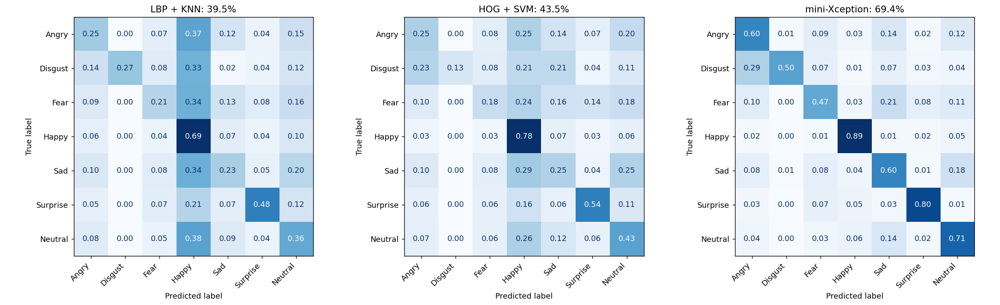

# Facial emotion recognition: LBP+KNN vs HOG+SVM vs mini-Xception

TD4, Machine Learning for Robotics (ENSTA). Three emotion classifiers trained on FER-2013
(7 classes: Angry, Disgust, Fear, Happy, Sad, Surprise, Neutral) and compared in a Gradio interface
that runs all three models **on the same face** and shows, for each one, the label, the confidence and the latency (ms).

**Demo video:** _link coming soon_

## Results

| Model | Mean latency (ms) | Accuracy on 50 images | Accuracy on the full test set (7,178 images) |
|---|---|---|---|
| LBP + KNN | **3.2** | 38 % | **39.5 %** |
| HOG + linear SVM (OvR) | **2.4** | 50 % | **43.5 %** |
| mini-Xception (CNN) | **6.5** (5.8 on GPU) | 72 % | **69.4 %** |

- Latency = feature extraction + inference, on CPU, averaged over 500 test images, first calls excluded (warm-up).
  For the CNN it includes test-time augmentation (2 passes: the image and its horizontal flip).
- Haar face detection + crop, shared by the three models, adds about 11 ms on a 640×480 image.
- Absolute latencies vary with machine load (we measured up to ~30 % higher on a busier run), but the ranking does not change.
- Details (std, p95, accuracy on 500 images): [reports/results.md](reports/results.md), generated by `python -m src.benchmark`.



## Installation

```bash
python3 -m venv .venv
source .venv/bin/activate
pip install -r requirements.txt
```

Tested with Python 3.10, PyTorch 2.14 (CUDA 13), OpenCV 4.14, scikit-learn 1.7, Gradio 6.
Exact versions are listed in [requirements-lock.txt](requirements-lock.txt). OpenCV must be 4.x:
version 5 removed `CascadeClassifier` (Haar detection).

The trained weights are included in `models/` (about 6 MB in total): **the app runs without the dataset**.
To retrain, put FER-2013 (Kaggle image-folder version) in `data/fer2013/` (see [data/README.md](data/README.md)).

## Usage

```bash
python app.py                 # CNN on CPU
python app.py --device cuda   # CNN on GPU
```

Then open http://localhost:7860. Two tabs:

- **Image**: upload a photo (or use the FER-2013 examples; in that case tick "already cropped", since Haar
  cannot find a face in a 48×48 image);
- **Webcam**: continuous analysis (about 4 frames per second).

The interface shows the image with the detected faces (the analyzed one, the largest, in green), the 48×48 face
actually sent to the models, then three cards side by side: label, confidence, latency for the current image and
session average, and the probabilities of the 7 classes. If no face is detected, the interface says so.

### Retraining and evaluation

```bash
python -m src.train_knn                  # model 1 (~5 min)
python -m src.train_svm                  # model 2 (~10 min, LinearSVC is single-threaded)
python -m src.train_cnn --mode full --width 2 --epochs 200 --erasing 0.5 --mix-prob 0.5   # model 3 (~20 min on an RTX 4060)
python -m src.benchmark                  # latency / accuracy table
```

## Repository layout

```
app.py              Gradio interface (image + webcam)
src/config.py       label order, paths
src/data.py         FER-2013 loading (.npz cache), train/validation split
src/features.py     block-wise LBP, HOG
src/train_knn.py    model 1: hyperparameter search, training, evaluation
src/train_svm.py    model 2
src/cnn.py          mini-Xception, augmentations, TTA
src/train_cnn.py    model 3
src/pipeline.py     Haar detection, alignment, crop, timed prediction of the 3 models
src/evaluation.py   accuracy, per-class report, confusion matrices
src/benchmark.py    results table for the submission
models/             trained weights
reports/            metrics, confusion matrices, learning curves
```

## Method

### Data

FER-2013: 48×48 grayscale images, 28,709 for training and 7,178 for testing (the Kaggle split is the official
Training / PublicTest + PrivateTest split). Label order: 0=Angry, 1=Disgust, 2=Fear, 3=Happy, 4=Sad, 5=Surprise, 6=Neutral.
The dataset is imbalanced: 7,215 training images for Happy, only 436 for Disgust.

The Kaggle split has no validation set: **all hyperparameters are selected on a stratified 10 % validation split
taken from train** (fixed seed). The test set is only used for the final evaluation.

### Model 1: LBP + KNN

- `uniform` LBP (`skimage.feature.local_binary_pattern`), image split into 4×4 = 16 blocks, one normalized
  histogram per block, concatenated (P+2 bins per block, i.e. 160 features for P=8).
- Grid: (P, R) ∈ {(8,1), (8,2), (8,3), (16,2)}, k ∈ {1, 3, 5, 9, 15, 25, 35, 50}, uniform or distance weights,
  Manhattan (p=1) or Euclidean (p=2) distance: 128 configurations ([reports/lbp_knn_grid.json](reports/lbp_knn_grid.json)).
- **Selected: P=8, R=2, k=50, distance weights, Manhattan.** Validation 40.2 %, test 39.5 %.
- Every configuration lands between 36 and 40 %: the representation, not the tuning, limits the model.
  Manhattan beats Euclidean almost everywhere, which makes sense when comparing histograms.
- Confidence = `predict_proba` (distance-weighted neighbor vote).

### Model 2: HOG + linear SVM (One-vs-Rest)

- HOG (`skimage.feature.hog`): 8×8 cells, 2×2 cell blocks, 9 orientations, L2-Hys normalization (900 features).
  Standardized features, `LinearSVC` (One-vs-Rest by default), C ∈ {1e-4, …, 1}.
- **Selected: C = 0.01.** Validation 44.7 %, test 43.5 %. The C curve is flat (44.1 to 44.7 %): the model is limited
  by the features, not by the regularization.
- 6×6 cells (1,764 features) were also tested: 44.8 % on both validation and test, i.e. +0.1 point on validation,
  within noise. We keep the 8×8 cells from the assignment
  ([reports/hog_svm_grid_cells_6_8.json](reports/hog_svm_grid_cells_6_8.json)).
- Confidence: `LinearSVC` does not output probabilities, so its scores are calibrated with `CalibratedClassifierCV`
  (sigmoid, 3 folds).

### Model 3: mini-Xception

**Weights: trained by us** in PyTorch on FER-2013 (no pretrained weights, so no risk of a label-order mismatch).
Architecture after Arriaga et al. (2017): two 3×3 convolutions, then 4 residual blocks (2 depthwise separable
convolutions, BatchNorm, ReLU, max-pooling, strided 1×1 shortcut), a convolution to 7 channels and global average
pooling. Input 48×48 normalized to [0, 1], confidence = softmax.

Augmentations (computed per batch on GPU): horizontal flip, ±10° rotation, ±10 % shift, ±10 % zoom,
±20 % brightness and contrast.

The model was improved in three steps, each one selected on the validation set:

| Version | Changes | Parameters | Validation | Test |
|---|---|---|---|---|
| v1 | Assignment recipe: Adam lr 1e-3, `ReduceLROnPlateau`, batch 64, early stopping on val-loss (stopped at epoch 86) | 57 k | 63.4 % | 63.7 % |
| — | v1 + label smoothing 0.1, warmup + cosine over 100 epochs, flip TTA | 57 k | 66.2 % | 66.0 % |
| v2 | same, width ×2 (every channel count doubled) | 202 k | 67.4 % | 69.0 % |
| **v3** | v2 + random erasing (p=0.5) + mixup/cutmix (1 batch out of 2), 200 epochs | 202 k | 69.0 % | **69.4 %** |

- The new recipe (label smoothing, cosine schedule, TTA) brings about 3 points (63.4 → 66.2 % on validation),
  width ×2 about 1 point on validation (3 on test). TTA alone accounts for 1.5 to 2 points
  (v3: 67.9 % without, 69.4 % with), at twice the latency.
- The strong augmentations of v3 gain 1.6 points on validation but only 0.4 on test, within the statistical
  uncertainty (about ±0.5 point on 7,178 images): we have reached the ceiling of this architecture on this dataset.
- The final model is retrained on the whole train set (train + validation) with the selected schedule.
- Learning curves: [reports/](reports/) (`mini_xception_*_curves.png`).

### Per-image pipeline

1. Grayscale conversion and face detection with a Haar cascade (`haarcascade_frontalface_default`);
   if there are several faces, the largest one is analyzed; if there is none, the interface says so.
2. Alignment: the eyes are detected (`haarcascade_eye`) in the upper half of the face and the image is rotated so
   that the eye line is horizontal (skipped if both eyes are not found or if the angle exceeds 25°).
3. Crop with a 10 % margin, resize to 48×48.
4. The three models run one after the other, each timed separately (`time.perf_counter`).

## Analysis

### Confused classes

| Per-class recall | Angry | Disgust | Fear | Happy | Sad | Surprise | Neutral |
|---|---|---|---|---|---|---|---|
| LBP + KNN | 25 % | 27 % | 21 % | 69 % | 23 % | 48 % | 36 % |
| HOG + SVM | 25 % | 13 % | 18 % | 78 % | 25 % | 54 % | 43 % |
| mini-Xception | 60 % | 50 % | 47 % | 89 % | 60 % | 80 % | 71 % |

- **Disgust → Angry**: the strongest confusion, and it even grows with the CNN (14 % for KNN, 23 % for SVM,
  29 % for the CNN). Both expressions share the same cues (frowning eyebrows, wrinkled nose, raised upper lip).
  Disgust is also by far the rarest class (1.5 % of train): the model learns its boundary poorly and folds it into Angry.
- **Fear → Sad** (13 %, 16 %, 21 %) and **Fear → Surprise** (8 to 14 %): Fear is the hardest class for every model.
  It shares the open mouth and wide eyes with Surprise, and the inner-raised eyebrows with Sad.
- **Sad ↔ Neutral** (Sad → Neutral 18 to 25 %; Neutral → Sad 9 to 14 %): low-intensity expressions, often ambiguous
  even for humans (human accuracy on FER-2013 is estimated at about 65 %).
- **Bias towards Happy** in the classical models: KNN labels 33 to 38 % of Angry, Disgust, Fear, Sad and Neutral
  faces as Happy. Happy is the majority class (25 % of train) and its samples dominate the LBP histogram space.
  The SVM reduces this bias (21 to 29 %) and the CNN removes it (1 to 6 %).
- Happy and Surprise, the most visually distinctive expressions (smile, O-shaped open mouth), are the best
  recognized by all three models.

### Accuracy vs. speed

- **The CNN is 26 points more accurate than the best classical model**, at a latency of the same order of magnitude
  (6.5 ms vs. 2.4 to 3.2 ms on CPU). All three models are comfortably real-time: even with detection (about 11 ms),
  an image is processed in about 20 ms, and detection is the dominant cost.
- On GPU, the CNN only drops to 5.8 ms: with such a small network and a single image, the CPU↔GPU transfer and the
  kernel launch overhead eat most of the gain.
- The CNN is also the lightest model (0.8 MB): KNN has to store its whole training set (5.1 MB) and its inference
  cost grows with it.
- Hand-crafted features plateau: all 128 LBP+KNN configurations score 36 to 40 %, and HOG only gains 0.1 validation
  point when going from 8×8 to 6×6 cells. The CNN learns task-specific features and benefits from data augmentation,
  which the classical models cannot exploit in the same way.
- The CNN's TTA illustrates the trade-off: +1.5 points for twice the latency.

### Limitations

- Haar is sensitive to pose, lighting and resolution. On FER-2013 faces upscaled and pasted into a 640×480 image
  (very tight crops, no context), it finds 78 % of them. With a webcam (frontal face, normal context), detection is
  much more reliable, but a CNN detector (e.g. YuNet) would be more robust.
- FER-2013 contains label noise and a few blank or non-face images, which caps the achievable accuracy (the best
  published results, with networks of several million parameters, are around 73 to 76 %).
- The Haar crop does not exactly match the framing of FER-2013 images: real-world performance (webcam) may be lower
  than on the test set.

## References

- I. Goodfellow et al., "Challenges in Representation Learning: A report on three machine learning contests", 2013 (FER-2013).
- O. Arriaga, M. Valdenegro-Toro, P. Plöger, "Real-time Convolutional Neural Networks for Emotion and Gender Classification", 2017 (mini-Xception).
- T. Ojala, M. Pietikäinen, T. Mäenpää, "Multiresolution gray-scale and rotation invariant texture classification with local binary patterns", PAMI 2002.
- N. Dalal, B. Triggs, "Histograms of Oriented Gradients for Human Detection", CVPR 2005.
- P. Viola, M. Jones, "Rapid Object Detection using a Boosted Cascade of Simple Features", CVPR 2001.
